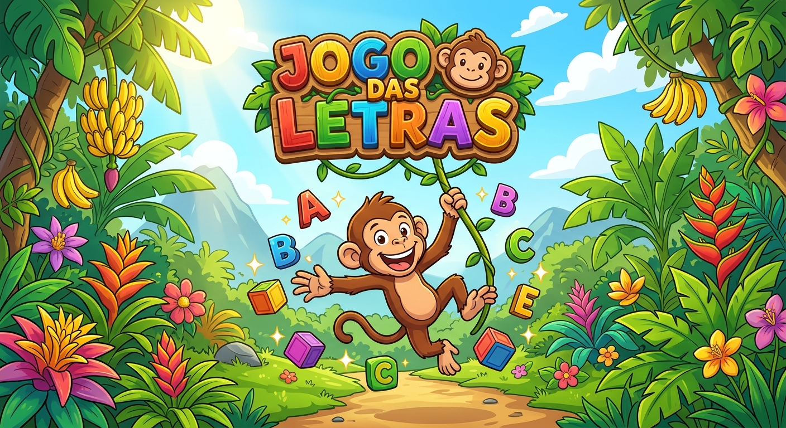

# Jogo das Letras

Jogo educativo para crianças que estão aprendendo as letras. A criança olha o desenho de um animal e escolhe com qual letra o nome dele começa.

Criei este projeto unindo minha experiência como educadora ao que estou aprendendo em programação.

## Jogue agora

[Abrir o jogo](https://ludnice11-lang.github.io/projetojogo/)

## Como funciona

- Cada animal tem 3 letras para escolher e um tempo para responder.
- A criança tem uma chance em cada animal.
- O nome do animal aparece só depois da resposta.
- No final, o jogo mostra os pontos e os erros.
- Quem acerta mais do que erra pode colocar o nome no ranking.
- O ranking fica salvo apenas no navegador usado para jogar.

## Tecnologias usadas

- HTML
- CSS
- JavaScript
- localStorage
- GitHub Pages

## O que aprendi

- Usar listas e objetos em JavaScript
- Criar elementos da página com JavaScript
- Controlar o tempo com `setInterval` e `setTimeout`
- Salvar informações no navegador com `localStorage`
- Encontrar e corrigir erros usando o Console

## Próximas ideias

- Colocar som para ajudar crianças que ainda não leem
- Mostrar os animais em ordem aleatória
- Criar novos temas